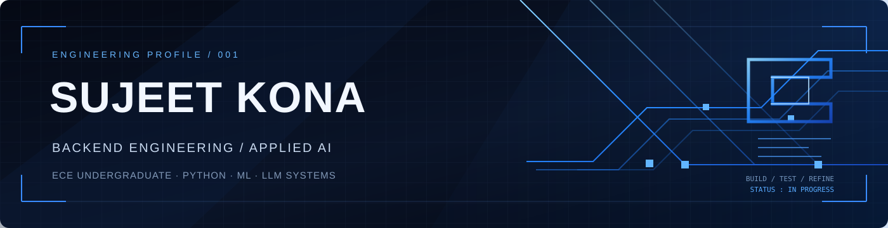

### APPLIED AI ENGINEERING
**Python Backend · Machine Learning · LLM Systems**

---

## About

I'm a third-year Electronics and Communication Engineering student interested in building reliable software systems. I work across **Python backend development, machine learning, and LLM engineering**. I value clear fundamentals, careful evaluation, and code that is straightforward to understand and maintain.

## Technology

<table>
  <tr>
    <td colspan="5"><strong>LANGUAGES & BACKEND</strong></td>
  </tr>
  <tr>
    <td align="center" width="20%"> Python</td>
    <td align="center" width="20%"> C</td>
    <td align="center" width="20%"> FastAPI</td>
    <td align="center" width="20%"> PostgreSQL</td>
    <td align="center" width="20%"> SQLAlchemy</td>
  </tr>
  <tr>
    <td colspan="5"><strong>MACHINE LEARNING</strong></td>
  </tr>
  <tr>
    <td align="center"> PyTorch</td>
    <td align="center"> Scikit-learn</td>
    <td align="center"> XGBoost</td>
    <td align="center"> Pandas</td>
    <td align="center"> NumPy</td>
  </tr>
  <tr>
    <td colspan="5"><strong>LLM ENGINEERING</strong></td>
  </tr>
  <tr>
    <td align="center"> Hugging Face</td>
    <td align="center">PEFT</td>
    <td align="center">LoRA / QLoRA</td>
    <td align="center">TRL</td>
    <td align="center">Evaluation</td>
  </tr>
  <tr>
    <td colspan="5"><strong>RETRIEVAL & SEARCH</strong></td>
  </tr>
  <tr>
    <td align="center"> Qdrant</td>
    <td align="center">BM25</td>
    <td align="center">Hybrid Retrieval</td>
    <td align="center">Reranking</td>
    <td align="center">Citations</td>
  </tr>
  <tr>
    <td colspan="5"><strong>TOOLS & QUALITY</strong></td>
  </tr>
  <tr>
    <td align="center"> Docker</td>
    <td align="center"> Git</td>
    <td align="center"> GitHub</td>
    <td align="center"> pytest</td>
    <td align="center">Linux</td>
  </tr>
</table>

---

## GitHub Activity

 

FUNDAMENTALS FIRST · THOUGHTFUL ENGINEERING · CONTINUOUS IMPROVEMENT

